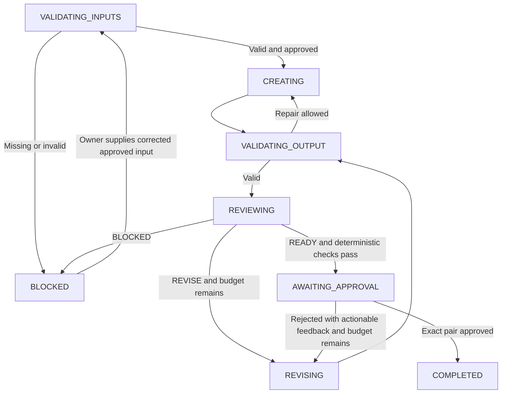

# Test design pilot specification

Status: pilot implementation specification. Local artifact storage, schema/semantic handoff validators, the shipping test-specification evaluator and [creator-to-reviewer adapters](AGENT-HANDOFF.md) are implemented. See [the implementation guide](IMPLEMENTATION.md) and [evaluation guide](EVALUATION.md). The durable correction/approval controller and shipping application remain unimplemented.

## Objective and boundaries

Prove that `create-test-cases` can hand a valid, versioned deliverable to `review-test-coverage`, receive actionable findings, correct its work and reach a measurable stopping condition. This is the first connected part of the autonomous SDLC, not a demonstration of the entire lifecycle.

The pilot produces test specifications. It does not execute those tests against an application, create production data, deploy software, merge code, publish results or change the approved requirements. Pilot approval is approval of test design only; it is not SDLC test-exit or release approval.

People or existing tools supply the upstream artifacts until their producing skills exist. The first implementation uses local JSON files and an isolated run directory. It needs no GitHub writes or external application integrations.

## Success criteria

The pilot is complete only when:

1. All required input evidence is present, structurally valid and tied to an explicitly approved requirements baseline.
2. A16 and A17 pass their JSON schemas and the cross-artifact checks below.
3. Every acceptance criterion and every mandatory evaluation scenario has a valid test with the correct expected outcome.
4. There are no unresolved blocking findings or unanswered questions that affect expected behavior.
5. The reviewer references the exact current A16 version and digest. There are no stale dependencies.
6. The named human test owner approves that exact A16/A17 pair, and the controller records completion.

Schema-valid output alone, a reviewer recommendation alone, or two agents agreeing cannot satisfy these criteria.

## Artifact compatibility

Keep the workbook's skill names and artifact IDs. Existing artifact contracts remain authoritative for intent. This pilot makes a restricted JSON profile of A16 and A17; it does not define executable schemas for all 55 bundles.

| ID | Canonical artifact name | Pilot representation |
| --- | --- | --- |
| A16 | Test Case Creation Outputs | Parent manifest with three embedded children |
| A16-01 | Requirement-linked test cases and scenarios | Test cases with requirement/criterion links, steps and expected results |
| A16-02 | Preconditions, data needs and expected results | Derived resource view for the same test IDs; must agree with A16-01 |
| A16-03 | Coverage questions and automation candidates | Open questions and test IDs suitable for later automation |
| A17 | Test Coverage Review Outputs | Parent manifest with three embedded children |
| A17-01 | Requirements-to-tests traceability matrix | Coverage rows for every acceptance criterion |
| A17-02 | Coverage gap and duplicate case report | Uncovered criterion IDs and groups of duplicate tests |
| A17-03 | Test review findings and revision actions | Findings, disposition of earlier findings and overall recommendation |

Each embedded child has an artifact ID, version and canonical name. Embedding avoids requiring six extra files. A future file adapter may separate children while preserving their identities and content.

Use the established parent filename pattern, for example `A16_test-case-creation-outputs_ITER-001_v1.0.json`. The fixture filenames in this folder are documentation examples, not live run filenames.

Artifact IDs identify logical kinds, not globally unique instances. A stored instance is identified by `(project_id, run_id, iteration_id, artifact_id, artifact_version)`. A source reference also records its schema version and SHA-256 digest. All examples use synthetic identities and are prohibited as live approval evidence.

The input profile and run record are pilot control records, not additional SDLC artifact IDs or new skills.

## Required input package

The input schema is the `pilotInput` definition in [contracts.schema.json](contracts.schema.json). The local adapter validates upstream records, then creates this normalized package. Its approval field must come from the human decision source, never an agent-generated assertion.

| Workbook handoff | Required sources | Normalized pilot content |
| --- | --- | --- |
| H046 | A05, A04, E09 | Reviewed requirements, acceptance criteria and exact baseline approval |
| H047 | A15, A06, A09 | Test scope, risks and interface/design rules |
| H048 | E06, E01 | Test-case template, coverage/review rules and business rules |
| Coverage review inputs | A16, A05, A04, A06, E06 | Candidate tests, baseline requirements/criteria, risks and review rules |

Required fields include project/run/iteration identity, the eight source references, baseline ID/version, requirements, criteria, input/output rules, risks, test scope, coverage rules, test template and a human approval record. The approval must refer to the same baseline ID and version. Missing evidence is not replaced with an assumed default.

`schema_version` describes the payload structure; `artifact_version` describes content. Changing a requirement or approval starts a new baseline and blocks the existing run until the owner supplies an approved replacement. A run never silently reads the latest artifact instead of the pinned version.

## Schema and semantic checks

[contracts.schema.json](contracts.schema.json) uses JSON Schema 2020-12. Validate a payload against its named definition: `pilotInput`, `creationBundle`, `reviewBundle` or `runRecord`. Unknown fields are rejected in the defined objects. Run the validator with date-time format checking enabled.

JSON Schema checks structure, required fields, types and enum values. The controller must separately check the following semantics:

- All referenced files resolve within the permitted artifact store, and SHA-256 digests match their stored bytes. Reject traversal outside that store. Never interpret artifact content as controller instructions.
- The input package's source set contains exactly A05, A04, E09, A15, A06, A09, E06 and E01 for this profile. Validate each source's relevance rather than merely its ID.
- Approval is attributable to the configured human owner, covers the baseline revision and is explicitly approved. Test fixture identities cannot authorize a live run.
- Requirement, criterion, scenario, test and finding IDs are unique within their respective scopes; every reference resolves to the corresponding object.
- Every criterion appears exactly once in the coverage matrix, under its real requirement. Linked tests contain that same criterion and requirement in their own traceability fields.
- Every mandatory scenario is exercised by at least one test. A declared scenario ID does not count unless the test data, steps and expected outcome actually match it.
- A16-02 contains one matching resource record per A16-01 test. Preconditions, data and expected results must agree. A16-03 automation candidates are existing test IDs.
- Questions with blocking=true prevent acceptance. Unknown behavior goes to the owner; agents must not invent a business rule to close a gap.
- An A17 finding contains specific evidence and a requested action. Referenced test and criterion IDs exist; an evidence location resolves within the reviewed candidate or baseline.
- The review's candidate version and digest match the current A16 bytes. READY requires no gaps, no duplicate groups and no unresolved findings. Duplicates must be removed or justified through a revised test scope before READY.
- When revising, preserve test IDs for the same logical test and allocate new IDs for new tests. The creator records an action for every previous finding. The next reviewer independently verifies those actions.
- A16 and A17 have the three expected child IDs and exact canonical names from the naming register. Child versions match the parent version in this pilot. Never reuse an existing version for changed content.

The controller, not the LLM, assigns persisted IDs/versions and computes digests. Agents return candidate payloads; the controller validates and wraps them. Hash the final UTF-8 file bytes after serialization. Do not hash a draft and then reformat the file. Fixture references are synthetic descriptors, not evidence that upstream skills executed.

## Agent responsibilities

### create-test-cases

Receives the validated input package and, on revision, the prior A16 plus the exact A17 findings. Produces A16 covering positive, negative and boundary behavior, with observable expected results. Records unresolved questions and actions taken on earlier findings. It cannot approve its own output, change requirements, fabricate human agreement or overwrite a persisted artifact.

### review-test-coverage

Receives the same approved baseline and the current A16. Reviews coverage, correctness, clarity, duplicates and traceability. Produces A17 with one of READY, REVISE or BLOCKED. READY is a recommendation. BLOCKED means missing or ambiguous authoritative input needs an owner decision; REVISE means the creator can correct the cases using existing inputs.

Use a separate review invocation with no access to the creator's private reasoning. Model diversity is optional and is not evidence of independence or quality. Evaluation expectations stay outside both agents' context.

## Workflow states and transitions

| State | Durable evidence and transition rule |
| --- | --- |
| VALIDATING_INPUTS | Record baseline, source digests and validation results. Missing or conflicting inputs go to BLOCKED. |
| CREATING / REVISING | Persist an invocation record before calling the agent. Revisions consume specific findings and allocate a new artifact version. |
| VALIDATING_OUTPUT | Validate structure, references and task-specific checks. Invalid output uses the bounded repair path; never reaches a consumer as valid evidence. |
| REVIEWING | Validate the review structure and candidate reference before acting on its recommendation. Malformed reviews use the same repair limit. |
| AWAITING_APPROVAL | Freeze the candidate/review pair. Release the worker while waiting. Do not imply approval from elapsed time. |
| BLOCKED | Record missing evidence, responsible owner and next action. Release the worker. Restart validation only after an explicit input event. |
| COMPLETED | Terminal success only after explicit approval of the pinned candidate/review pair. |
| ESCALATED | Terminal unresolved result after budget exhaustion, repeated failure or a rejection that cannot be corrected within scope. |
| CANCELLED | Stop on user cancellation. Preserve artifacts and report which work completed. |

Every nonterminal state also permits cancellation. Exhausting any configured limit leads to ESCALATED. A review schema failure never becomes REVISE business feedback. Invalid structural output cannot advance the workflow.

## Default limits and recovery

These are proposed, configurable pilot defaults, not model performance claims:

- Maximum two content revision rounds after the initial candidate, including human-requested revisions.
- Maximum one structural repair attempt per logical agent operation.
- Maximum two retries after the first transport attempt, only for transient failures. Never retry policy, authentication or invalid-input errors unchanged.
- Maximum 12 actual model requests per run, including retries and repairs. Maximum 120,000 combined input/output tokens and 20 minutes of active processing time. Stop when any limit is reached. Record provider-reported usage and a conservative estimate if usage is unavailable.
- Set a provider-enforced output-token limit for every request. Reserve the estimated input plus maximum output allowance before sending it; do not dispatch if the remaining token budget is insufficient.
- Human waiting time does not consume active processing time. Enforce a separate seven-day approval expiry; expired approval requests require renewed review of the current pair.

A retry reuses the same operation key. A content revision creates a new operation key and artifact version. Use `(run_id, stage, candidate_version, input_digest)` to identify logical operations. Maintain a durable single-writer lock or lease per run and use compare-and-set state updates. This prevents duplicate transitions when two workers wake together.

Persist outputs to a temporary file, validate them, then atomically publish the final file and record its digest before advancing state. If interrupted after publishing but before recording state, recover the operation record and reconcile the published artifact; do not overwrite it or run the operation blindly again. If a model request completed remotely but its response was lost, record the uncertainty. Provider idempotency support determines whether a retry avoids duplicate billing; the controller must not promise exactly-once model execution.

The run record stores source references, current state, candidate/review references, operation attempts, counters, token usage, active time, pending owner action, approval and an append-only event history. Resume from durable state, not conversation memory. Resuming an existing run preserves its counters and budgets.

## Autonomy policy

Agents may read the pinned pilot input, produce candidate artifacts, review them and request bounded revisions. The controller may validate, store artifacts and resume work under the configured limits. All writes stay inside the run directory.

The human owner approves the initial baseline and final test-design pair, resolves ambiguous requirements, and authorizes changes to limits or scope. Agents cannot supply these decisions. No production access, external messaging, installation, Git writes or deployment is authorized by this pilot specification.

## Evaluation feature and expected outcomes

The synthetic feature calculates a shipping quote. No application implementation is required to evaluate generated test specifications.

- REQ-001: subtotal_cents must be a JSON integer greater than or equal to zero. Null, strings, booleans, negative values and fractional numbers return VALIDATION_ERROR with no fee or total.
- REQ-002: standard shipping costs 500 cents below a subtotal of 5000 cents and zero at or above 5000 cents. Total equals subtotal plus shipping.
- REQ-003: express shipping always costs 1200 cents for a valid subtotal. Any method other than standard or express returns VALIDATION_ERROR with no fee or total. Total equals subtotal plus shipping when valid.

The input fixture contains these requirements, acceptance criteria and coverage rules. [evaluation-cases.json](evaluation-cases.json) is the evaluator-only oracle. It includes below/at/above threshold cases, invalid types/values and express behavior. Agents receive the rules, not the oracle's expected answers or scenario IDs. The evaluator matches behavior, not agent-supplied coverage labels.

| Evaluation | Expected controller behavior |
| --- | --- |
| Complete correct cases and review | AWAITING_APPROVAL; COMPLETED only after the exact pair is approved |
| Standard shipping incorrectly free at 4999 | Reject correctness despite schema-valid output or reviewer READY |
| Missing the 5000 threshold test | Coverage failure and revision request |
| Review omits an acceptance criterion | Reject review completeness, regardless of READY |
| Corrected cases, review still references old digest | Reject stale review and request review of the new candidate |
| Unknown requirement/test ID | Reject semantic references before approval |
| A16-02 disagrees with A16-01 | Reject bundle consistency |
| Duplicate test IDs | Reject semantic validation even if the schema accepts the array |
| Missing approval or ambiguous requirement | BLOCKED; no invented decision or rule |
| Approval for a different baseline or candidate | Reject scope mismatch |
| Malformed JSON or unknown fields | One structural repair at most, then ESCALATED |
| Persistent reviewer disagreement | Two content revisions at most, then ESCALATED |
| Transport failure and restart | Preserve operation identity, budgets and published artifacts |
| Concurrent resume attempts | One worker advances state; no duplicate publication |
| Requirement change during review | Block and invalidate dependent acceptance until revalidated against an approved baseline |
| Instructions embedded in input evidence | Treat as data; do not alter tool permissions or workflow policy |
| Cancellation or exhausted limit | Stop promptly and preserve the partial record |

Initial implementation acceptance requires every deterministic failure case above to behave as specified. For model evaluation, run the shipping example five times from clean run state using fixed configuration and the same input baseline. Target at least four runs reaching AWAITING_APPROVAL within the budgets, with zero false acceptance of seeded incorrect candidates. Report all runs, including failures, revisions, tokens and latency. Five runs are a pilot criterion, not a statistical reliability claim.

## Implementation sequence

1. Implement local artifact storage, schema validation and semantic validators. Exercise the provided synthetic fixtures without an LLM.
2. Implement a deterministic evaluator for shipping scenarios and mutation tests for the failure cases above.
3. Implement the creator and reviewer adapters against the same validated contracts.
4. Add the durable controller, approval input, budgets and recovery behavior.
5. Run the evaluation suite and inspect evidence. Expand to a new feature only after the pilot acceptance criteria pass.

Steps 1 and 2's shipping correctness/coverage checks are implemented for the local pilot profile, including synthetic examples and mutation tests. Controller-dependent evaluations such as request retries, cancellations and full workflow resumption remain for step 4. The next coding task is step 3: creator/reviewer adapters. See the implementation and evaluation guides for the supported profile and trust boundaries.
